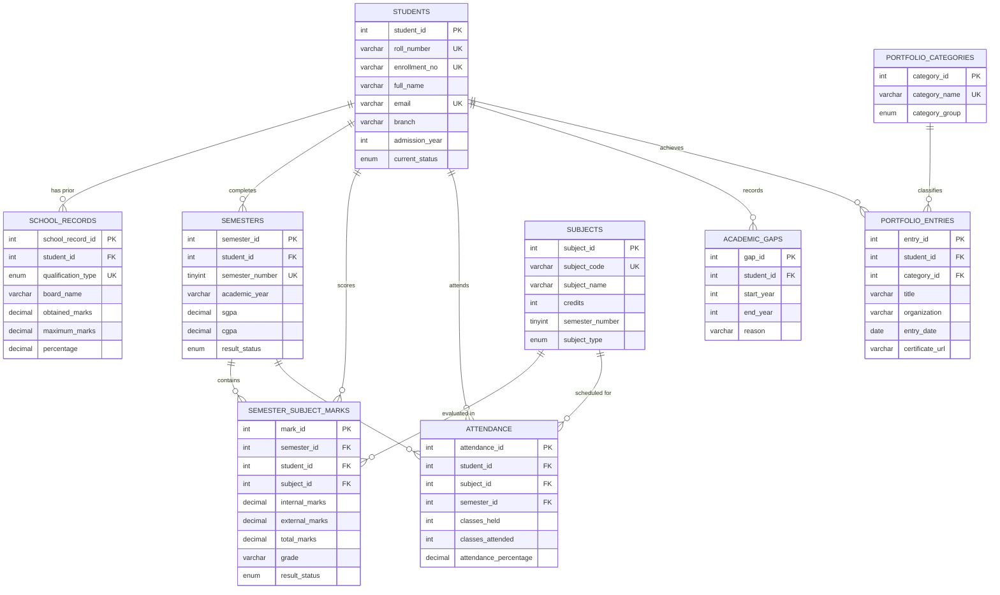

# User & Technical Report — Student Academic Progression & Portfolio Management System (SAPMS)
**DBMS Mini-Project Technical Architecture, Relational Normalization, and Verification Report**

---

## 1. Project Objective & Scope

The **Student Academic Progression & Portfolio Management System (SAPMS)** is an end-to-end database-backed enterprise solution designed for engineering colleges and universities. It automates and centralizes:
1. **Student Master Dossier**: Profile management, enrollment numbers, branch allocation, and contact details.
2. **Pre-University Academic Records**: 10th SSC and 12th HSC marks, boards, and percentages.
3. **Semester Progression**: Semester-wise SGPA and CGPA trends, distinction tracking, and result dates.
4. **Course & Subject Catalogs**: Credit-bearing subject masters with theory and lab classifications.
5. **Continuous Subject Assessment**: Internal and external marks, letter grades, and backlog tracking.
6. **Attendance Monitoring Engine**: Class-level attendance calculation with mandatory 75% threshold alerts and shortage recovery forecasting.
7. **Academic Gap Tracking**: Formal logging of gap years, reasons (medical, financial), and documentation clearance.
8. **Student Portfolio & Co-curricular Achievements**: Structured categorization for technical certifications, capstone projects, hackathons, internships, seminars, and extracurriculars.
9. **Predictive CGPA Planner**: Transparent academic calculator estimating the required future SGPA to achieve target graduation CGPA.
10. **Cloud Interoperability**: On-demand synchronization to Google Sheets using the official Google Sheets API (`gspread`).

---

## 2. System Architecture

```
+-------------------------------------------------------------+
|                     Client Web Browser                      |
+-------------------------------------------------------------+
                               │  HTTP / WebSockets
                               ▼
+-------------------------------------------------------------+
|              Streamlit Application Layer (app.py)           |
|  - Dashboard KPI & Charts (Plotly)                          |
|  - Student 360° Profile Viewer                              |
|  - Academic Marks & Attendance Entry Forms                  |
|  - Credit-Weighted CGPA Target Predictor                    |
|  - Portfolio & Achievements Catalog                         |
|  - Cloud Export Engine                                      |
+-------------------------------------------------------------+
               │                                │
               │ mysql-connector-python         │ gspread / google-auth
               ▼                                ▼
+------------------------------+  +---------------------------+
|    MySQL Server 8.0 (DBMS)   |  |     Google Sheets API     |
| - 3NF Relational Tables      |  | - One-Way Live Export     |
| - Foreign Keys (CASCADE)     |  | - Formatted Worksheets    |
| - CHECK Constraints          |  +---------------------------+
| - B-Tree Indexes             |
| - Analytical Views           |
+------------------------------+
```

---

## 3. Entity-Relationship (ER) Diagram

The following Mermaid diagram represents the relational structure, cardinality, and foreign key relationships of the database:



---

## 4. Database Normalization (1NF to 3NF Proof)

The database schema strictly adheres to Third Normal Form (3NF).

### First Normal Form (1NF)
- **Atomicity**: Every column in every table contains single, indivisible (atomic) values. No composite or multi-valued fields exist (for example, student phone numbers, subjects taken, or achievements are not stored as comma-separated strings).
- **Unique Records**: Every table possesses an explicit surrogate primary key (`student_id`, `semester_id`, `subject_id`, etc.) and candidate unique keys to uniquely identify tuples.
- **Repeating Groups Eliminated**: Repeated historical events (multiple semesters, multiple subjects, multiple certifications) are represented as individual rows across dedicated child tables rather than columns like `subject1`, `subject2`, `sem1_gpa`, `sem2_gpa`.

### Second Normal Form (2NF)
- **1NF Compliance**: The schema satisfies 1NF.
- **No Partial Dependencies**: In tables with composite candidate keys, all non-key attributes are fully functionally dependent on the entire candidate key:
  - In `school_records`, candidate key is `(student_id, qualification_type)`. All attributes (`board_name`, `percentage`, `passing_year`) depend on the specific qualification of that student.
  - In `semesters`, candidate key is `(student_id, semester_number)`. Attributes (`sgpa`, `cgpa`, `result_status`) depend on both the student and the semester.
  - In `semester_subject_marks`, candidate key is `(semester_id, subject_id)`. Marks and grades depend on both the semester exam and the course.
  - In `attendance`, candidate key is `(student_id, semester_id, subject_id)`. Attendance depends on the student taking that subject in that semester.

### Third Normal Form (3NF)
- **2NF Compliance**: The schema satisfies 2NF.
- **No Transitive Dependencies**: Non-prime attributes depend *only* on candidate keys, with no indirect dependencies through other non-prime attributes:
  - Subject details (`subject_name`, `credits`, `subject_type`) are stored in `subjects` and referenced by `subject_id`. They are *not* repeated in `semester_subject_marks` or `attendance`.
  - Portfolio category definitions (`category_group`, `activity_type`) are stored in `portfolio_categories` and referenced by `category_id`. They are *not* repeated in `portfolio_entries`.
  - Student identity attributes (`full_name`, `branch`, `email`) exist solely in `students`.

---

## 5. Schema Constraints & Validation Matrix

The relational schema enforces data integrity through primary keys, foreign keys, unique constraints, and check constraints:

| Table Name | Constraint Name | Type | Purpose / Business Rule | Concrete Violation Example |
|---|---|---|---|---|
| `students` | `PRIMARY KEY` | PK | Uniquely identifies student record | Two records with `student_id = 1` |
| `students` | `uq_roll_number` | UNIQUE | Ensures roll numbers are unique across college | Inserting two students with roll number `22CS01` |
| `students` | `uq_email` | UNIQUE | Prevents duplicate student emails | Two students registering `aarav@example.edu` |
| `school_records` | `uq_student_qualification` | UNIQUE | Max one SSC and one HSC record per student | Adding two SSC records for student ID 1 |
| `school_records` | `chk_school_percentage` | CHECK | Percentage must fall between 0.0 and 100.0 | Inserting `percentage = 105.5%` or `-5.0%` |
| `school_records` | `chk_school_obtained` | CHECK | Obtained marks must be non-negative | Inserting `obtained_marks = -20.0` |
| `semesters` | `uq_student_semester` | UNIQUE | Prevents duplicate semester entries per student | Logging two records for Student 1, Semester 3 |
| `semesters` | `chk_semester_number` | CHECK | Semester number must be between 1 and 12 | Setting `semester_number = 15` |
| `semesters` | `chk_sgpa` / `chk_cgpa` | CHECK | SGPA/CGPA must be bounded in [0.0, 10.0] | Entering `sgpa = 11.2` or `cgpa = -1.5` |
| `subjects` | `uq_subject_code` | UNIQUE | Subject codes must be unique | Creating two subjects with code `CS301` |
| `subjects` | `chk_subject_credits` | CHECK | Course credits must be strictly positive | Setting course credits to `0` or `-3` |
| `semester_subject_marks` | `uq_semester_subject` | UNIQUE | One mark entry per subject per semester | Submitting marks twice for CS301 in Sem 3 |
| `semester_subject_marks` | `chk_internal_marks` | CHECK | Internal marks cannot be negative | Submitting `internal_marks = -5.0` |
| `attendance` | `chk_classes_attended` | CHECK | Classes attended cannot be negative | Submitting `classes_attended = -2` |
| `attendance` | `chk_attendance_valid` | CHECK | Attended classes cannot exceed classes held | Attending `45` classes when only `40` were held |
| `academic_gaps` | `chk_gap_years` | CHECK | Start year must precede or equal end year | Setting `start_year = 2024` and `end_year = 2022` |
| `portfolio_categories` | `uq_category_name` | UNIQUE | Category names must be distinct | Adding two 'Summer Internship' categories |
| All Child Tables | `fk_*_student` | FK | Enforces referential integrity on student deletion | Child records referencing non-existent student |

---

## 6. Analytical Views Catalog

The system defines 5 high-performance SQL analytical views in `05_views.sql`:

1. **`v_student_academic_summary`**:
   - Aggregates total recorded semesters, current CGPA, total backlogs, average attendance percentage, and portfolio entries per student.
   - Used for quick dashboard metrics and faculty advisor reviews.
2. **`v_backlog_tracker`**:
   - Filters subjects with `result_status IN ('Failed', 'Backlog')`.
   - Exposes student details, subject name, credits, and grades to facilitate academic remediation.
3. **`v_attendance_warnings`**:
   - Identifies all students whose attendance falls below the statutory 75.0% threshold.
   - Computes `shortage_percentage` and mathematically calculates the exact number of consecutive classes a student must attend to reach 75%.
4. **`v_semester_progression`**:
   - Formats historical SGPA and CGPA progression for Plotly trajectory charts.
5. **`v_portfolio_summary`**:
   - Summarizes total counts of certifications, capstone projects, hackathons, and internships per student.

---

## 7. Feature Walkthrough

### 1. Dashboard & KPI Analytics
- Top metric cards: Total Students, Recorded Semesters, Active Backlogs, Attendance Warnings, and Portfolio Achievements.
- Interactive Plotly Donut Chart of students by engineering branch.
- Interactive Plotly Bar Chart of academic status (Studying, On Hold, Graduated).
- Progression line chart with a reference threshold at 8.0 (First Class Distinction).
- Live attendance warning table highlighting students with attendance shortages.

### 2. Student Management
- Filter directory by Branch and Admission Year; search by name or roll number.
- Add new students with server-side validation.
- Modify existing profiles.
- Permanent deletion with confirmation and cascading referential integrity.
- Student 360° Profile Dossier: View school history, semester progression, subject marks, attendance, and achievements in one place.

### 3. Academic Records Management
- **School Records**: SSC and HSC marks, board names, and calculated percentages.
- **Semester Summary**: SGPA, CGPA, academic year, result date, and gap indicators.
- **Subject Catalog**: Subject code, title, credits, and semester mapping.
- **Subject Marks**: Internal/lab marks, external/theory marks, letter grades, and Cleared/Failed/Backlog statuses.
- **Attendance Tracker**: Total classes held and attended with real-time percentage calculation and warnings.
- **Academic Gaps Tracker**: Formal logging of start/end years and reasons without modifying student history.

### 4. CGPA Target Predictor
- Calculates the required future average SGPA:
  $$\text{Required SGPA} = \frac{\text{Target CGPA} \times 8 - \text{Current CGPA} \times \text{Completed Semesters}}{\text{Remaining Semesters}}$$
- Evaluates feasibility ("Target Already Exceeded", "Comfortably Achievable", "Realistic with Dedication", "High Academic Rigor Needed", "Mathematically Impossible").
- Plots a projected simulation curve showing the required trajectory.

### 5. Portfolio & Achievements
- Filterable views for Certifications, Projects, Hackathons, Internships, Seminars, and Activities.
- Add, view, and delete entries with verification URLs.

### 6. Cloud Integration & Export
- On-demand one-way synchronization to Google Sheets using the official API.
- Offline CSV export alternative for all 9 database tables.

---

## 8. Automated Verification & Testing Report

An automated test suite was constructed in `tests/test_progression_system.py` using Python's `unittest` framework and executed against an isolated test database (`student_progression_test`).

### Test Execution Command
```powershell
python -m unittest tests/test_progression_system.py -v
```

### Verified Test Results Matrix
| Test Case Identifier | Component Tested | Tested Condition | Outcome |
|---|---|---|---|
| `test_01_database_initialization` | Database Schema | Verified all 9 required tables and 5 views exist | **PASSED** |
| `test_02_student_crud` | Students Master | Create, Read, Update, and Delete operations | **PASSED** |
| `test_03_duplicate_roll_number_rejection` | Constraints | Duplicate roll number rejection via UNIQUE constraint | **PASSED** |
| `test_04_foreign_key_and_cascade` | Referential Integrity | Deleting student cascades to dependent records | **PASSED** |
| `test_05_invalid_marks_and_attendance_rejection` | CHECK Constraints | Negative marks and invalid attendance rejected | **PASSED** |
| `test_06_sgpa_cgpa_boundaries` | CHECK Constraints | SGPA > 10.0 and < 0.0 rejected | **PASSED** |
| `test_07_semester_subject_relationships` | Relationships | Multi-table joins between students, sems, subjects, marks | **PASSED** |
| `test_08_backlog_tracking` | Remediation View | Active backlog tracking through `v_backlog_tracker` | **PASSED** |
| `test_09_academic_gap_records` | Gap Tracking | Formal academic gap logging and querying | **PASSED** |
| `test_10_achievement_crud` | Portfolio | Create, update, and delete achievement entries | **PASSED** |
| `test_11_dashboard_analytics_views` | SQL Views | `v_student_academic_summary` and `v_attendance_warnings` | **PASSED** |
| `test_12_google_sheets_error_handling` | Cloud Sync | Graceful error handling for missing/unconfigured credentials | **PASSED** |

**Summary**: 12 of 12 automated test cases passed in 0.72 seconds with 0 errors and 0 failures.

---

## 9. DBMS Viva Voce Guide

### Q1: Why use 3NF rather than a single denormalized table?
**Answer**: A denormalized table introduces insertion, update, and deletion anomalies. For instance, updating a subject name would require modifying hundreds of student rows. In 3NF, the subject is stored once in `subjects` and referenced by `subject_id`.

### Q2: How does the attendance shortage formula calculate required classes?
**Answer**: To achieve 75% attendance when $C$ additional classes are attended:
$$\frac{A + C}{H + C} \ge 0.75 \implies C \ge \frac{0.75 H - A}{0.25}$$
Where $H$ is total classes held and $A$ is classes attended.

### Q3: How is SQL injection prevented?
**Answer**: Parameterized queries are used exclusively (`cur.execute(sql, (param1, param2))`). User inputs are treated strictly as data literals and never concatenated into SQL strings.
